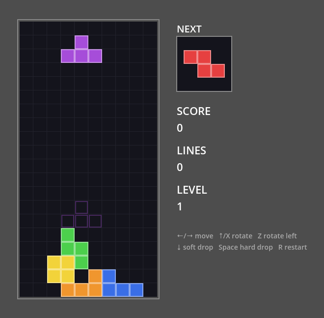

# godot-mcp-loop

**AI エージェントが Godot 4 のゲームを編集し、_その結果を自分で確かめられる_ ようにする MCP サーバー + エディタアドオン。**
「変更 → 実行 → 観察 → 判定」の検証ループに特化しています。

[English README](README.md) · [ツール](docs/tools.md) · [シナリオ](docs/scenarios.md) · [クライアント設定](docs/clients.md) · [セキュリティ](docs/security.md) · [プロトコル](docs/protocol.md)


シーンを編集できる Godot 向け MCP はすでに多数ありますが、**その編集が本当に動いたかを確かめる** 手段はほとんどありません。
godot-mcp-loop はエージェントにテストプレイヤーの道具一式を渡します。ゲームの起動、実際の入力送信、条件待機、
実行中の状態取得、スクリーンショット、エラー収集、そして失敗時の値まで返す宣言的なシナリオテストです。
編集は意図的に慎重な設計で、すべて Undo 可能・事前プレビュー可能・適用前に検証済み・プロジェクト内に限定されます。

## エージェントができること

```text
godot_status                                    → 接続 OK、Godot 4.7.2、main.tscn を編集中
script_write res://player.gd (dry_run)          → unified diff。コンパイルエラーがあれば行番号付きで返す
script_write res://player.gd                    → 書き込み（Undo 可能）
game_run                                        → ゲーム起動、ランタイム接続
game_input [{action: move_right, hold_ms: 1000}]
game_wait_for Player position:x > 250           → 0.8 秒で成立
screenshot                                      → （画像）
logs_read source=game min_level=error           → []
scenario_run res://tests/move_right.yaml        → PASSED（7/7 ステップ）
```

## 特長

- **閉じたループ**: `game_run`、`game_input`（アクション・キー・マウスを実時間で。値の毎フレーム記録も可）、`game_wait_for`
  （毎フレーム判定、タイムアウト時は最後の値を返す）、`game_query`、`screenshot`、`logs_read`。
- **シナリオテスト**: YAML/JSON のプレイテスト → ステップごとの成否、失敗時スクショ、ゲーム内エラー。[詳細](docs/scenarios.md)
- **安全な編集**: すべての変更は Godot の Undo 履歴に記録。`edit_undo` は MCP 経由の変更だけを戻し、人の編集は戻しません。
  全編集ツールに `dry_run`。GDScript は**書き込む前に**コンパイル検証。プロパティ値も変更前に全件検証。
- **サンドボックス**: localhost 限定 + セッションごとのトークン認証。`res://` のみ。`.godot/`・`.git/`・アドオン自身への書き込み禁止。
  任意コード実行ツールは持ちません。[セキュリティ](docs/security.md)
- **エラーで止まらない**: Godot のデバッガはスクリプトエラーでゲームを一時停止しますが、アドオンがエラーを記録して自動継続するため、
  エージェントがハングせずエラーを把握できます。
- **ゲーム側に追加ポート不要**: ゲームとエディタは Godot 標準のデバッガ接続で通信します。
- **厳選した 22 ツール**: 数百のツールより、モデルが迷わず使える粒度を重視。

## 動作環境

- Godot **4.7**（4.7.2 で検証済み）。4.5〜4.6 でも動く見込み（4.5 で追加された `Logger` API を使用）ですが未検証です。
- Node.js **20 以上**
- MCP クライアント: Claude Code、Cursor、Claude Desktop、Codex、Hermes Agent など

## インストール

**npm で入れる場合**(Node.js 20 以上):

> MCP 公式レジストリに
> [`io.github.AI-osho/godot-mcp-loop`](https://registry.modelcontextprotocol.io/v0/servers?search=godot-mcp-loop)
> として掲載されています。レジストリ対応のクライアントからは一覧に出ます（手順は下と同じです）。

1. **アドオン** — アドオンはサーバーと同じバージョンが必要です。サーバー自身にコピーと有効化をさせます。
   ```bash
   npx -y godot-mcp-loop@latest install-addon /絶対パス/my-game --skill
   ```
   `--skill` を付けると、エージェント用スキル(下の手順 5)も入ります。次の手順で使うバージョンが表示されます。
2. **クライアント** — 表示されたバージョンでサーバーを登録します。例: Claude Code
   ```bash
   claude mcp add godot-loop -- npx -y godot-mcp-loop@<バージョン> --project /絶対パス/my-game
   ```
   その他のクライアント: [docs/clients.md](docs/clients.md)
3. Godot エディタでプロジェクトを開き、エージェントに `godot_status` を呼ばせて接続を確認。

**ソースから入れる場合**:

1. **アドオン** — `addons/mcp_loop` を自分のプロジェクトの `addons/` にコピーし、
   *プロジェクト › プロジェクト設定 › プラグイン › MCP Loop* を有効化。オートロード `MCPLoopRuntime` が登録されます
   （書き出したゲームでは無効）。
2. **サーバー** —
   ```bash
   git clone https://github.com/AI-osho/godot-mcp-loop.git
   cd godot-mcp-loop/server && npm ci && npm run build
   ```
3. **クライアント** — 例: Claude Code
   ```bash
   claude mcp add godot-loop -- node /絶対パス/godot-mcp-loop/server/dist/index.js --project /絶対パス/my-game
   ```
   その他のクライアント: [docs/clients.md](docs/clients.md)
4. Godot エディタでプロジェクトを開き、エージェントに `godot_status` を呼ばせて接続を確認。
5. **エージェント用スキル**（推奨） — `.claude/skills/godot-mcp-loop` を自分のプロジェクトの `.claude/skills/`
   （全プロジェクトで使うなら `~/.claude/skills/`）にコピーします。
   - 教える内容：ループの回し方、`game_step` を使った決定的な確認、シナリオの型、ドット絵の作り方
   - [Agent Skills](https://agentskills.io) 形式なので、スキルを読める他のエージェントでも使えます。

### 新しいゲームプロジェクトを作る

```bash
scripts/new-game.sh ~/games/my-game --name "My Game" --register-claude
```

このコマンドで、次のものがそろった Godot プロジェクトができます。
- 有効化済みのアドオン
- エージェント用スキル
- 短い `AGENTS.md` / `CLAUDE.md`
- `scenarios/` フォルダ
- `PROGRESS.md`(目標・状況・済み・次・決定事項・既知の問題。エージェントが更新します)
- Claude Code のプロジェクト設定 `.claude/settings.json`
- 最初の git コミット

あわせて、そのフォルダ用に MCP サーバーを Claude Code へ登録します。別の Claude Code 設定に登録したいときは `--claude-config DIR` を指定してください。作成後は `godot -e --path ~/games/my-game` で開きます。

プロジェクト設定は、長い制作でも作業が途切れないようにするためのものです。
- セッション開始時のフックで、`PROGRESS.md`、最近のコミット、未コミットの変更をエージェントに渡します。起動時、再開時、`/clear` の後、コンテキスト圧縮の後に働きます。
- godot-loop のツールは、確認なしで使えます。この許可は、そのフォルダで Claude Code の信頼確認(trust)に同意すると有効になります。
- 破壊的なシェルコマンド(`rm -rf`、force push、`git reset --hard`、`git clean`)は禁止します。

### デモを試す

このリポジトリ自体が小さなプラットフォーマー（`examples/platformer`、矢印キー + Space）を含む Godot プロジェクトです。
Godot で開き、サーバーの `--project` をリポジトリのルートに向けて、エージェントに
「`res://examples/platformer/scenarios/move_right.yaml` を `scenario_run` で実行して」と頼んでください。
`intentional_failure.yaml` を実行すると失敗レポートの見え方を確認できます。

### 5 分で試す

1. **アドオンを入れる**（`addons/mcp_loop` をコピーし、プラグインを有効化し、エージェント用のスキルも配置します）:
   ```bash
   cd my-game && npx -y godot-mcp-loop@latest install-addon . --skill
   ```
2. **Godot（4.5 以上）でプロジェクトを開く**: `godot -e --path .` — エディタと一緒にブリッジが 127.0.0.1 で待ち受けます。
3. **MCP クライアントを接続**: `npx -y godot-mcp-loop@latest --project /絶対パス/my-game` を登録し、`godot_status` を
   呼びます。Godot の版、プロジェクト、開いているシーンが返れば成功です。
4. **1 つ変更して、1 つ確かめる**: 「コインを 1 枚追加して、`scenario_run {"path": "res://scenarios/coins.yaml"}` を
   実行して」と頼みます。失敗したステップは、実際の値とスクリーンショット付きで返ります。
5. **録画する**: 同じシナリオを `"movie": {}` と `"save_to": "res://qa/evidence/tour"` 付きで実行し、
   `qa/evidence/tour/movie.gif` を開きます。実行の全体と、要所のコマを並べた画像が残ります。

## 上級サンプル

[`examples/`](examples/) に完成したゲームが 4 本あります。どれも AI エージェントが godot-mcp-loop を使い、1 つの依頼文から
コード、NES 風のドット絵（`image_write`）、入力アクション、テスト用フック、回帰シナリオまで作りました。そのうえで
独立に検証しています（全シナリオ合格、ランダム入力でもエラー 0）。

| | ゲーム | 作成したモデル | 規模 | シナリオ |
|---|---|---|---|---|
|  | [落ち物パズル（Falling Blocks）](examples/blocks/) — SRS 方式の回転と壁キック、ゴースト表示、レベルと得点、シード固定の出現順 | Claude Opus 5.5（Claude Code） | 381 行 | 4 |
|  | [縦シューティング](examples/shooter/) — 5 ウェーブに 4 種類の敵、3 つの攻撃パターンを持つボス、爆発、星空スクロール、ドット絵 11 枚 | Claude Opus 5.5（Claude Code） | 805 行 | 4 |
|  | [横スクロールアクション](examples/action/) — 加減速と可変ジャンプ、穴と動く足場のある 8 画面のステージ、踏んで倒せる敵、コイン、ゴール、3 層の多重スクロール、ドット絵 12 枚 | DeepSeek V4.1 Flash（Claude Code） | 967 行 | 4 |
|  | [RPG『星剣のルカ』](examples/rpg/) — オリジナルの物語とキャラクターによる NES 風 RPG。タイトルとプロローグ、マス移動、NPC との会話、ランダムエンカウント、呪文・道具・逃走・レベルアップのある正面視点の戦闘、ボスとエンディング | DeepSeek V4.1 Flash（Claude Code） | 2,284 行 | 6 |

`game_run {"scene": "res://examples/shooter/shooter.tscn"}` で起動でき（シーンを開いて F6 でも可）、
`scenario_run {"path": "res://examples/shooter/scenarios/4_boss_clear.yaml"}` で検証を再実行できます
（フォルダを指定すると `{"path": "res://examples/shooter/scenarios"}` で全シナリオをまとめて実行します）。
操作方法などの詳細: [examples/README.md](examples/README.md)（英語）

## ツール一覧

| 区分 | ツール |
|---|---|
| 状態 | `godot_status`, `project_info`, `project_list`, `project_connect`（プロジェクト切り替え） |
| エディタ | `editor_launch`（Godot を探してプロジェクトを開く）, `editor_quit` |
| シーン | `scene_open`, `scene_create`, `scene_save`, `scene_tree` |
| ノード | `node_add`, `node_delete`, `node_get`, `node_set` |
| スクリプト | `script_read`, `script_write`, `script_edit`, `script_attach` |
| ファイル・素材 | `file_write`（YAML/JSON/テキスト）, `image_write`（ドット絵 PNG）, `input_action_set`, `project_setting_set`（メインシーン・画面サイズ・ストレッチ） |
| 取り消し | `edit_undo` |
| 実行・観察 | `game_run`, `game_stop`, `game_query`, `game_ui_audit`, `game_in_view`, `game_ray`, `game_contacts`, `game_input`, `game_wait_for`, `game_set`, `game_call`, `game_pause`, `game_step`, `logs_read`, `screenshot` |
| ビルド | `project_export`（書き出し。出力は `res://build/` のみ、プリセット必須、シェルなし） |
| 判定 | `scenario_run`（証拠フォルダ、`movie` で GIF とコンタクトシート）、`test_run`(GUT / GdUnit4 の単体テスト) |

詳細: [docs/tools.md](docs/tools.md)（英語）

## ヘッドレス / CI

*プロジェクト設定 › Editor › Run › Main Run Args* に `--headless` を入れると、ゲームをウィンドウなしで実行できます
（`screenshot` 以外はすべて動作）。本リポジトリの CI も Linux 上でヘッドレスのエディタとゲームを起動して
エンドツーエンドテストを実行しています（[.github/workflows/ci.yml](.github/workflows/ci.yml)）。

## 開発

```bash
scripts/test-godot-unit.sh                   # GDScript ユニットテスト（ヘッドレス）
cd server && npm run typecheck && npm test   # TypeScript ユニットテスト
npm run build && npm run test:e2e            # 実際のヘッドレスエディタ + ゲームでの E2E
E2E_GAME_WINDOW=1 npm run test:e2e           # ゲームをウィンドウ付きで（スクショ検証あり）
```

## 制限事項

- 1 つのエディタに同時接続できる MCP クライアントは 1 つ（新しい接続が古い接続を置き換えます）。
- `script_write` の事前検証は GDScript のみ。新規ファイルが**自分自身の** `class_name` を参照する場合、検証がやや緩くなります。
- C# プロジェクトは未対応です。

## ライセンス

MIT © OSHO
