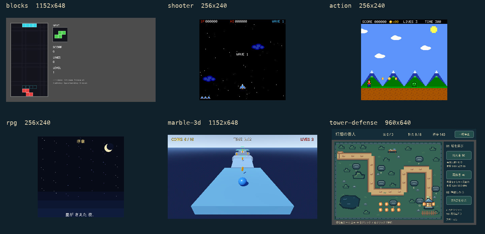

# godot-mcp-loop

**MCPクライアントから、Godot 4の編集・実行・動作確認を行うためのツールです。**
TypeScript製のMCPサーバーとGodotエディタアドオンを使い、AIエージェントがシーンやスクリプトを変更し、
入力を送り、実行中の状態や画面を調べます。成果物は通常のGodotプロジェクトとして扱えます。

[English](README.md) · [はじめに](docs/getting-started.ja.md) · [構成と仕組み](docs/architecture.ja.md) · [サンプル](docs/samples.ja.md) · [旧版からの改善](docs/sample-upgrades.ja.md)

## 編集して終わらず、動いた結果まで確かめる

1. **編集**：シーンを調べ、ノード・GDScript・入力設定などを変更する。
2. **実行**：ゲームを起動し、Godotのアクション・キー・マウス入力を送る。
3. **観察**：状態値、画面、UI配置、物理の動き、ログを確認する。
4. **判定**：期待値と比較し、YAML/JSONのシナリオで同じ確認を繰り返す。

操作を選んで呼び出すのはAIクライアントです。ゲームを自動完成させるクラウドサービスではありません。
ルール・絵・音・ステージ・遊び心地は作者による設計と検証が必要です。
対応する編集には事前確認と取り消しがありますが、シーン保存やファイル書き込みはそれぞれ別の操作です。

## 6作品のサンプル



アドオンを入れずに単体起動したGodotの画面です。RPGは序章の一場面です。
[各作品の操作・プロジェクト・原寸画像](docs/samples.ja.md)。

<!-- sample-showcase:start -->
| 配布名 | 作品 | 確かめられること |
|---|---|---|
| `blocks` | Falling Blocks | 回転、盤面状態、得点 |
| `shooter` | Vertical Shooter | 移動と射撃、ウェーブ、ボスの変化 |
| `action` | Side-scroller | 可変ジャンプ、足場、当たり判定 |
| `rpg` | 星剣のルカ | 会話、戦闘、状態遷移 |
| `marble-3d` | Marble Run | 転がし、ジャンプ、チェックポイント、接触 |
| `tower-defense` | 灯畑の番人 | 塔の配置、一時停止、勝敗、再挑戦 |
<!-- sample-showcase:end -->

6作品とも、遊ぶだけならAIアカウントやMCP設定は不要です。それぞれ同じ道具の異なる使いどころを示します。
制御用の試験シナリオが成功したことと、通常操作でゲーム全編を遊び終えたことは区別します。

## サンプルを試す

コピー用のコマンドにはNode.js20以降、ゲームにはGodot4.7（4.7.2で確認）を使います。
作業フォルダーで、上表から配布名と新しい空きフォルダーを選んでください。例：

```sh
npx -y godot-mcp-loop@0.12.0 sample shooter ./my-shooter
godot --headless --path ./my-shooter --import
godot --path ./my-shooter
```

AIから編集/試験するときだけ、同じ選択済み配布物からアドオンを明示導入し、[クライアントを設定](docs/clients.md)します。
遊ぶだけなら両方不要です。インストーラーは実行したサーバーの接続コマンドを表示しますが、
通常登録の追加や既存接続の再起動は行いません。[詳しい導入](docs/getting-started.ja.md)。

## 本体の構成

- [`server/src/`](server/src/)：MCPツールの定義・入力検査、対象プロジェクトへの接続、シナリオの進行。
- [`addons/mcp_loop/`](addons/mcp_loop/)：Godotエディタでの編集と、標準デバッガを通したゲーム側への要求転送。
- ゲーム側ランタイム：入力、状態取得、フレーム送り、画面、ログ。ゲーム操作用の別ポートは追加しません。
- 任意の[`server/authoring/`](server/authoring/)：PNGの固定加工処理。原画生成はクライアント側の承認済み手段を利用します。

```text
MCPクライアント → 標準入出力のサーバー → 認証付きlocalhost接続 → Godotエディタ → デバッガ → 実行中ゲーム
```

[構成と仕組み](docs/architecture.ja.md)では、エディタとゲームの役割、リポジトリ構成、データの流れ、保存の扱いを説明しています。

## 主な機能と配布状態

| 分野 | できること |
|---|---|
| シーン・コード | シーンの確認/作成、ノードとGDScriptの編集、入力と対応するプロジェクト設定の変更 |
| 実行・観察 | 入力、状態取得、フレーム記録、条件待機、物理フレーム送り、UI監査、画面、ログ |
| 繰り返し検証 | シナリオの比較と証拠保存、録画、導入済みGUT/GdUnit4の試験、プリセットからの書き出し |
| 原画・素材 | 制作方針/依頼/PNG返却の記録、再現可能な加工、プレビュー、改変検査、標準2Dノードへの配置 |
| 一括構築 | node_add_tree（0.12.0）：空の対象シーンへ2D/UI構成を最大64ノード・深さ8で追加。保存は別 |

| 配布物 | ツールと利用可能な範囲 |
|---|---|
| 現行 **0.12.0** | node_add_treeを含む**49**ツール、紹介6作品と内部の互換・試験用シーン |
| 従来 **0.11.0** | **48**ツール。静的診断doctorは0.11.0から、原画・素材制作は**0.10.0**から |

サーバーとアドオンは同じ選択済み配布物から揃えます。版表示だけでは内容の一致を証明できず、ソースの変更が
公開パッケージに入っているとも限りません。doctorは独立した静的診断CLIで、MCPツールや実行時接続の証明ではありません。
[ツール参照](docs/tools.md) · [原画・素材制作](docs/art-production.ja.md) · [一括構築](docs/scene-tree-build.ja.md)。

## ツール一覧

<details>
<summary>0.12.0の49ツール（公開0.11.0は48）</summary>

| 区分 | ツール |
|---|---|
| 状態 | `godot_status`, `project_info`, `project_list`, `project_connect`（プロジェクト切り替え） |
| エディタ | `editor_launch`（Godot を探してプロジェクトを開く）, `editor_quit` |
| シーン | `scene_open`, `scene_create`, `scene_save`, `scene_tree` |
| ノード | `node_add`, `node_add_tree`（0.12.0：2D/UI の追加専用一括構築）, `node_delete`, `node_get`, `node_set` |
| スクリプト | `script_read`, `script_write`, `script_edit`, `script_attach` |
| 原画・素材制作（0.10.0以降） | `production_plan`, `art_request`, `art_register`, `asset_build`, `asset_preview`, `asset_verify`, `asset_scene_add` |
| ファイル・素材 | `file_write`（YAML/JSON/テキスト）, `image_write`（ドット絵 PNG）, `input_action_set`, `project_setting_set`（メインシーン・画面サイズ・ストレッチ） |
| 取り消し | `edit_undo` |
| 実行・観察 | `game_run`, `game_stop`, `game_query`, `game_ui_audit`, `game_in_view`, `game_ray`, `game_contacts`, `game_input`, `game_wait_for`, `game_set`, `game_call`, `game_pause`, `game_step`, `logs_read`, `screenshot` |
| ビルド | `project_export`（書き出し。出力は `res://build/` のみ、プリセット必須、シェルなし） |
| 判定 | `scenario_run`（証拠フォルダ、`movie` で GIF とコンタクトシート）、`test_run`(GUT / GdUnit4 の単体テスト) |

</details>

[全ツール参照](docs/tools.md) · [シナリオ](docs/scenarios.md) · [クライアント](docs/clients.md) · [プロトコル](docs/protocol.md)。

## 必要環境と信頼の前提

- サーバーはNode.js **20以降**。Godot **4.7**を検証対象とし、**4.7.2**で動作確認しています。
  Logger APIの導入は4.5ですが、それだけで4.5〜4.6の動作を保証するものではありません。
- AI操作にはClaude Code、Codex、Cursor、Claude Desktop、Hermes等のMCPクライアント。遊ぶだけなら不要です。
- Python **3.11以降**と**Pillow13.0.0**は任意のPNG加工だけに必要です。通常の編集・実行やnode_add_treeには不要で、自動導入しません。
  C#スクリプト検証は未対応です。
- 1つのエディタに対する認証済み接続は1つ。クライアントの登録や再接続は利用者が明示的に行います。

localhost認証とプロジェクトのパス保護は、**OSの隔離環境ではありません**。
プロジェクトを開く・検証する・動かす処理は、そのコードやプラグインを実行し得ます。
信頼できるプロジェクトを使い、クライアント側の承認も確認してください。取り消しは複数ファイルの完全な取引ではなく、
送信後に応答が失われた場合は、実際の状態を調べてから再試行します。[安全性の前提](docs/security.md)。

## 開発と検証

```sh
scripts/test-godot-unit.sh
cd server && npm ci
npm run typecheck && npm test
npm run build && npm run test:e2e
E2E_SAMPLES=1 npm run test:e2e
```

Linuxの画面付き試験にはxvfbと`E2E_GAME_WINDOW=1`が必要です。
正本と生成コピーの関係は[旧版との比較](docs/sample-upgrades.ja.md)にまとめています。両方を別々に手編集しません。
既定のplatformerシーンは内部の互換・試験用として残し、作品紹介には掲載しません。[公開手順](docs/releasing.md)。

## ライセンス

MIT © OSHO
