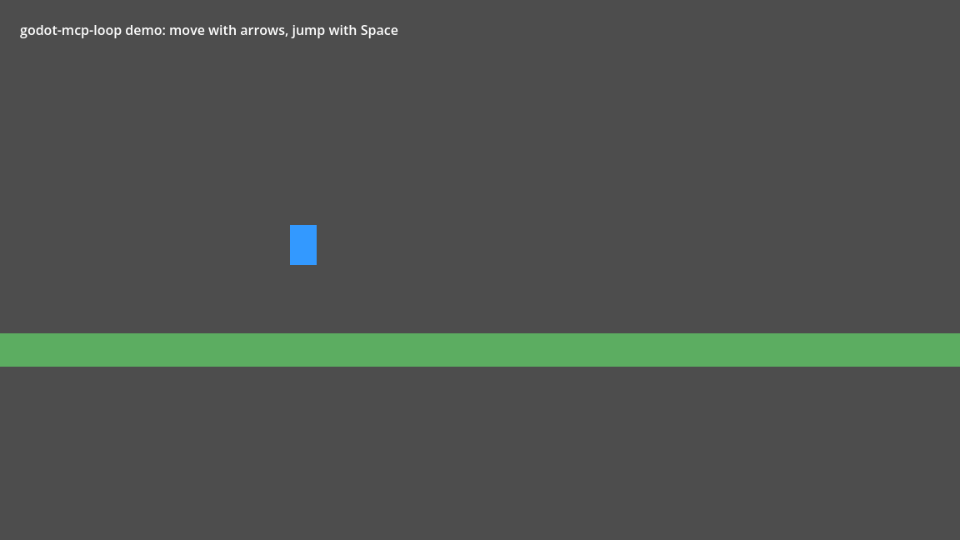
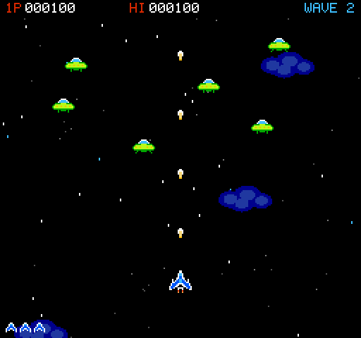
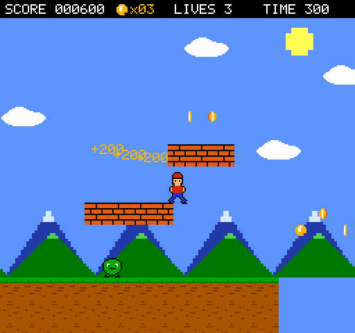
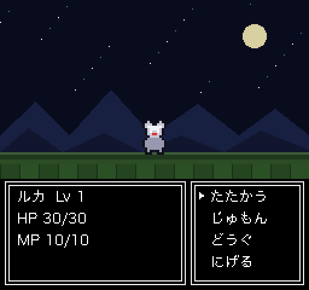

# godot-mcp-loop

**Let AI agents edit your Godot 4 game _and check their own work_.**
An MCP server + Godot editor addon focused on the verification loop: **change → run → observe → judge**.

[日本語 README](README.ja.md) · [Tools](docs/tools.md) · [Scenarios](docs/scenarios.md) · [Clients](docs/clients.md) · [Security](docs/security.md) · [Protocol](docs/protocol.md)



There are many Godot MCP servers that let an agent edit scenes. Few let it **find out whether the edit worked**.
godot-mcp-loop gives the agent a play-tester's toolkit — launch the game, send real input, wait for conditions,
read live state, take screenshots, collect errors — plus declarative scenario tests that return a pass/fail
report with the failing value. Editing is deliberately conservative: every change is undoable, previewable,
validated before it is applied, and sandboxed to your project.

## What an agent can do

```text
godot_status                                    → editor connected, Godot 4.7.2, main.tscn open
script_write res://player.gd (dry_run)          → unified diff; compile errors with line numbers if any
script_write res://player.gd                    → written (undoable)
game_run                                        → game running, runtime connected
game_input [{action: move_right, hold_ms: 1000}]
game_wait_for Player position:x > 250           → met after 0.8 s
screenshot                                      → (image)
logs_read source=game min_level=error           → []
scenario_run res://tests/move_right.yaml        → PASSED (7/7 steps)
```

## Highlights

- **Closed loop**: `game_run`, `game_input` (actions, keys, mouse, with real timing; can record values every frame), `game_wait_for`
  (checked every frame, reports the last value on timeout), `game_query`, `screenshot`, `logs_read`.
- **Scenario tests**: YAML/JSON play-tests → per-step pass/fail, failure screenshot, game errors. [Details](docs/scenarios.md).
- **Safe editing**: every edit goes through Godot's undo history; `edit_undo` only ever reverts edits made via MCP;
  `dry_run` everywhere; GDScript is compiled *before* it is written; property values are validated before anything changes.
- **Sandboxed**: localhost-only bridge with a per-session token; `res://` paths only; no writes to `.godot/`, `.git/`
  or the addon; no arbitrary-code-execution tool. [Security notes](docs/security.md).
- **Doesn't freeze on errors**: Godot's debugger pauses games on script errors; the addon logs the error and
  continues, so the agent sees it instead of hanging.
- **No extra ports in the game**: the game talks to the editor over Godot's own debugger connection.
- **22 focused tools** rather than hundreds — easier for models to use well.

## Requirements

- Godot **4.7** (tested on 4.7.2). 4.5–4.6 should work — the addon needs the `Logger` API added in 4.5 — but are not tested yet.
- Node.js **20+**
- An MCP client: Claude Code, Cursor, Claude Desktop, Codex, Hermes Agent, …

## Install

1. **Addon** — copy `addons/mcp_loop` into your project's `addons/` folder, then enable
   *Project › Project Settings › Plugins › MCP Loop*. The plugin registers an autoload `MCPLoopRuntime`
   (inactive in exported games).
2. **Server** —
   ```bash
   git clone https://github.com/AI-osho/godot-mcp-loop.git
   cd godot-mcp-loop/server && npm ci && npm run build
   ```
3. **Client** — e.g. Claude Code:
   ```bash
   claude mcp add godot-loop -- node /ABS/godot-mcp-loop/server/dist/index.js --project /ABS/my-game
   ```
   Other clients: [docs/clients.md](docs/clients.md).
4. Open your project in the Godot editor and ask the agent to call `godot_status`.

### Try the demo

This repository is itself a Godot project with a tiny platformer
(`examples/platformer`, arrow keys + Space). Open it in Godot, point the server at the repository root, and ask your
agent to *"run `scenario_run` on `res://examples/platformer/scenarios/move_right.yaml`"* — then try
`intentional_failure.yaml` to see a failure report.

## Advanced samples

Four complete games live in [`examples/`](examples/). Each was generated end to end by an AI agent through
godot-mcp-loop from a single prompt — code, NES-style pixel art (`image_write`), input actions, test hooks and
regression scenarios — and then verified independently: every scenario passes and random-input runs log no errors.

| | Game | Generated by | Size | Scenarios |
|---|---|---|---|---|
|  | [Tetris](examples/tetris/) — SRS rotation with wall kicks, ghost piece, levels and scoring, seeded piece order | Claude Opus 5.5 (Claude Code) | 381 lines | 4 |
|  | [Vertical shooter](examples/shooter/) — 4 enemy types over 5 waves, a boss with 3 attack patterns, explosions, scrolling starfield, 11 sprites | Claude Opus 5.5 (Claude Code) | 805 lines | 4 |
|  | [Side-scroller](examples/action/) — acceleration and variable jump, 8-screen stage with pits and moving platforms, stompable enemies, coins, goal, 3-layer parallax, 12 sprites | DeepSeek V4.1 Flash (Claude Code) | 967 lines | 4 |
|  | [RPG "星剣のルカ"](examples/rpg/) — NES-style RPG with an original story and cast: title and prologue, grid movement, NPC dialogue, random encounters, front-view battles with spells, items, fleeing and level-ups, a boss and an ending (Japanese text) | DeepSeek V4.1 Flash (Claude Code) | 2,284 lines | 6 |

Play one with `game_run {"scene": "res://examples/shooter/shooter.tscn"}` (or open the scene and press F6) and
replay its checks with `scenario_run {"path": "res://examples/shooter/scenarios/4_boss_clear.yaml"}`. Controls and
details: [examples/README.md](examples/README.md).

## Tools

| Area | Tools |
|---|---|
| Status | `godot_status`, `project_info` |
| Scenes | `scene_open`, `scene_create`, `scene_save`, `scene_tree` |
| Nodes | `node_add`, `node_delete`, `node_get`, `node_set` |
| Scripts | `script_read`, `script_write`, `script_edit`, `script_attach` |
| Files & assets | `file_write` (YAML/JSON/text), `image_write` (pixel-art PNG), `input_action_set` |
| Undo | `edit_undo` |
| Run & observe | `game_run`, `game_stop`, `game_query`, `game_input`, `game_wait_for`, `game_set`, `game_call`, `game_pause`, `game_step`, `logs_read`, `screenshot` |
| Judge | `scenario_run` |

Full reference: [docs/tools.md](docs/tools.md).

## Headless / CI

Add `--headless` to *Project Settings › Editor › Run › Main Run Args* to run games without a window (everything
except `screenshot` works). The repository's own CI runs a headless editor and headless games on Linux for the
end-to-end tests — see [.github/workflows/ci.yml](.github/workflows/ci.yml).

## Development

```bash
scripts/test-godot-unit.sh                   # GDScript unit tests (headless)
cd server && npm run typecheck && npm test   # TypeScript unit tests
npm run build && npm run test:e2e            # end-to-end against a real headless editor + game
E2E_GAME_WINDOW=1 npm run test:e2e           # same, with game windows (enables screenshot checks)
```

## Limitations

- One MCP client per editor at a time (a new connection replaces the old one).
- `script_write` validates GDScript only; a script that references its *own new* `class_name` may compile-check
  slightly less strictly.
- C# projects are not supported yet.

## License

MIT © OSHO
