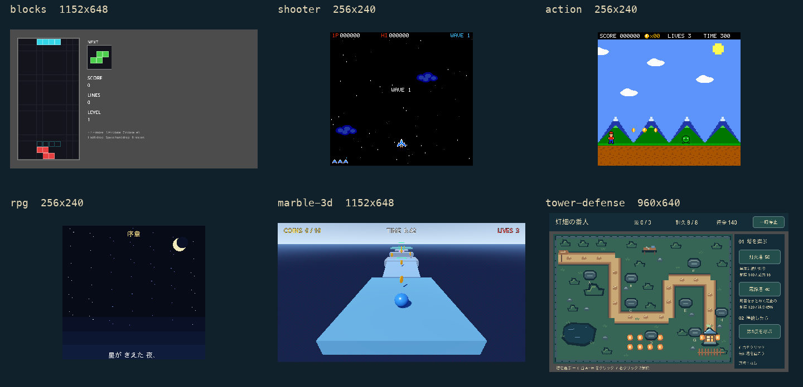

# godot-mcp-loop

**Edit, run, inspect and test Godot 4 projects from an MCP client.**
A TypeScript MCP server and a Godot editor addon let an AI coding agent change scenes/scripts,
send gameplay input, inspect live state and replay checks. Work remains in normal Godot projects and resources.

[日本語](README.ja.md) · [Get started](docs/getting-started.md) · [Architecture](docs/architecture.md) · [Samples](docs/samples.md) · [Sample changes](docs/sample-upgrades.md)

## The development loop

1. **Edit:** inspect a scene, change nodes, scripts or input settings.
2. **Run:** launch that project and send Godot action/key/mouse events.
3. **Observe:** read state, capture frames, inspect UI, physics and logs.
4. **Check:** compare expected values or replay YAML/JSON scenarios before making the next change.

The agent chooses and calls the tools; this is not a hosted service that automatically finishes a game.
Game rules, artwork, sound, level design and playtesting remain authored work. Supported edits offer preview and undo;
scene saving and file-backed operations have separate behavior.

## Six sample games



Native Godot captures from standalone projects, without the addon installed. The RPG frame is the prologue.
[Controls, project paths and original images](docs/samples.md).

<!-- sample-showcase:start -->
| Sample | Game | What to inspect |
|---|---|---|
| `blocks` | Falling Blocks | Rotation, board state and scoring |
| `shooter` | Vertical Shooter | Movement/fire, waves and boss transitions |
| `action` | Side-scroller | Variable jumps, platforms and collision |
| `rpg` | Luka of the Star Sword | Dialogue, battles and state transitions |
| `marble-3d` | Marble Run | Rolling, jumps, checkpoints and contacts |
| `tower-defense` | 灯畑の番人 | Tower placement, pause, victory/defeat and retry |
<!-- sample-showcase:end -->

All six run without an AI account or MCP setup. They show different uses of the same editing/observation tools;
a fixture check is not a claim that an agent completed every game through ordinary play.

## Try a sample

Use Node.js 20+ for the copy command and Godot 4.7 (tested with 4.7.2) to play. From a working folder,
choose one of the six IDs above and a new/empty destination:

```sh
npx -y godot-mcp-loop@0.12.0 sample shooter ./my-shooter
godot --headless --path ./my-shooter --import
godot --path ./my-shooter
```

For agent editing/testing, explicitly install the addon from the same selected distribution and configure your
[client](docs/clients.md). Play alone does not need either step. The installer supplies its actual server executable;
it does not register a client or restart an existing connection for you. [Full setup guide](docs/getting-started.md).

## How the pieces fit

- [`server/src/`](server/src/) exposes MCP tools, validates their input, connects to the selected project and runs scenarios.
- [`addons/mcp_loop/`](addons/mcp_loop/) edits through the Godot editor and forwards runtime requests through Godot's debugger.
- The game's runtime agent provides input, state, frame stepping, screenshots and logs. It adds no separate game-control listener.
- Optional [`server/authoring/`](server/authoring/) helpers process PNGs. Original image generation uses the client's separately authorized producer.

```text
MCP client → stdio server → authenticated loopback WebSocket → Godot editor → debugger → running game
```

[Architecture](docs/architecture.md) explains the two process layers, repository layout, data flow and persistence.

## Capabilities and distribution status

| Area | Use |
|---|---|
| Scene and code | Inspect/create scenes, edit nodes and GDScript, configure input and selected project settings |
| Runtime observation | Input, state queries, per-frame records, waits, physics stepping, UI audit, images and logs |
| Repeatable checks | Scenario assertions, evidence, recordings, installed GUT/GdUnit4 suites and preset-based exports |
| Artwork support | Brief/request/PNG receipts, deterministic processing, previews, change detection and standard 2D placement |
| Bounded construction | `node_add_tree` (since 0.12.0): one new 2D/UI subtree in an eligible empty scene, up to 64 nodes/depth 8; save separately |

| Distribution | Tools and availability |
|---|---|
| Current **0.12.0** | **49** MCP tools, including `node_add_tree`; six showcased games and a retained internal compatibility fixture |
| Previous **0.11.0** | **48** tools; static doctor CLI since 0.11.0; artwork tools since **0.10.0** |

Use the same selected distribution for the server and addon. Version labels alone do not prove equal contents;
source checkouts can differ from published packages. `doctor` is a static CLI, not an MCP tool or runtime connection test.
[Tool reference](docs/tools.md) · [Artwork](docs/art-production.md) · [Subtree construction](docs/scene-tree-build.md).

## Tools

<details>
<summary>All 49 tools in 0.12.0 (previous 0.11.0 has 48)</summary>

| Area | Tools |
|---|---|
| Status | `godot_status`, `project_info`, `project_list`, `project_connect` (switch projects) |
| Editor | `editor_launch` (finds Godot, opens the project), `editor_quit` |
| Scenes | `scene_open`, `scene_create`, `scene_save`, `scene_tree` |
| Nodes | `node_add`, `node_add_tree` (development: one bounded native 2D/UI subtree), `node_delete`, `node_get`, `node_set` |
| Scripts | `script_read`, `script_write`, `script_edit`, `script_attach` |
| Artwork production (0.10.0+) | `production_plan`, `art_request`, `art_register`, `asset_build`, `asset_preview`, `asset_verify`, `asset_scene_add` |
| Files & assets | `file_write` (YAML/JSON/text), `image_write` (pixel-art PNG), `input_action_set`, `project_setting_set` (main scene, viewport, stretch) |
| Undo | `edit_undo` |
| Run & observe | `game_run`, `game_stop`, `game_query`, `game_ui_audit`, `game_in_view`, `game_ray`, `game_contacts`, `game_input`, `game_wait_for`, `game_set`, `game_call`, `game_pause`, `game_step`, `logs_read`, `screenshot` |
| Build | `project_export` (release export from a preset into `res://build/` only, no shell) |
| Judge | `scenario_run` (evidence folder, `movie` → GIF + contact sheet), `test_run` (GUT / GdUnit4 unit tests) |

</details>

[Complete reference](docs/tools.md) · [Scenarios](docs/scenarios.md) · [Clients](docs/clients.md) · [Protocol](docs/protocol.md).

## Requirements and trust

- Node.js **20+** for the server; Godot **4.7** is the qualified target (tested with **4.7.2**).
  The Logger API was introduced in 4.5; that does not qualify 4.5–4.6 for this distribution.
- Claude Code, Codex, Cursor, Claude Desktop, Hermes or another MCP client for agent control; none is needed just to play.
- Python **3.11+** / **Pillow 13.0.0** only for optional PNG processing, not normal editing/play or `node_add_tree`.
  Dependencies are not installed automatically. C# script validation is not supported.
- One authenticated active MCP client per editor. Client setup/reconnection is explicit, not a side effect of copying a sample.

Loopback authentication and project-path guards are **not an OS sandbox**. Opening, validating or running a project
can execute its code/plugins. Use trusted projects and client-side approvals. Undo is not a cross-file transaction;
a missing response after dispatch does not prove that nothing changed. Inspect actual state before retrying.
[Security model](docs/security.md).

## Development

```sh
scripts/test-godot-unit.sh
cd server && npm ci
npm run typecheck && npm test
npm run build && npm run test:e2e
E2E_SAMPLES=1 npm run test:e2e
```

Windowed Linux checks need xvfb and `E2E_GAME_WINDOW=1`. Source authorities and generated copies are documented in
[sample changes](docs/sample-upgrades.md); do not edit both independently. The default `platformer` scene remains an
internal compatibility/test fixture and is not in the showcase. [Release procedure](docs/releasing.md).

## License

MIT © OSHO
