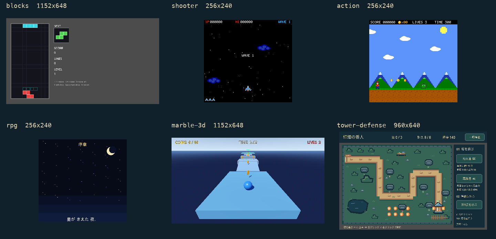

# サンプルゲーム

[English](samples.md) · [導入](getting-started.ja.md) · [構成](architecture.ja.md)

現在のソースでは6作品を紹介しています。いずれも、遊ぶだけならMCPアドオンやAIアカウントは不要です。
この6作品は**0.12.0**に同梱しています。従来版との違いは[配布状態](getting-started.ja.md#配布状態)を確認してください。



実際のGodot画面です。生成したイメージ画像ではなく、RPGは序章の一場面です。
[撮影の由来](images/samples-current-provenance.json)。原寸画像は各作品から開けます。

<!-- sample-showcase:start -->
| 配布名 | 作品 | 確かめられること |
|---|---|---|
| `blocks` | Falling Blocks | 回転、盤面状態、得点 |
| `shooter` | Vertical Shooter | 移動と射撃、ウェーブ、ボスの変化 |
| `action` | Side-scroller | 可変ジャンプ、足場、当たり判定 |
| `rpg` | 星剣のルカ | 会話、戦闘、状態遷移 |
| `marble-3d` | Marble Run | 転がし、ジャンプ、チェックポイント、接触 |
| `tower-defense` | 灯畑の番人 | 塔の配置、一時停止、勝敗、再挑戦 |
<!-- sample-showcase:end -->

## コピーと起動

作業フォルダーで、上表の配布名を指定してください。

```sh
npx -y godot-mcp-loop@0.12.0 sample shooter ./my-shooter
godot --headless --path ./my-shooter --import
godot --path ./my-shooter
```

新しい空きフォルダーを使ってください。ソース利用時はビルドしたCLIの絶対パスを明示し、導入/接続も同じビルドから揃えます。
組込例は入口のシーンを開いてF6、単体プロジェクトはF5で起動できます。
AIから編集/試験するときだけ、同じ配布物からアドオンを明示導入し、[クライアントを別途設定](clients.md)します。

## Falling Blocks (`blocks`)

- **目的:** ブロックを積み、横一列をそろえて消す。
- **操作:** ←/→移動、↑/XとZで回転、↓ソフトドロップ、Space即落下。
- **再挑戦:** Rで再開。ゲームオーバー後はEnterでも再開。
- **確かめること:** 盤面、回転/壁蹴り、出現順、ライン得点。
- **試験:** `examples/blocks/scenarios/`の4シナリオ。制御用フックの成功と通常操作での全編完走は別です。
- **プロジェクト:** 配布名`blocks`、入口`res://examples/blocks/blocks.tscn`。[操作ガイド](../examples/blocks/PLAY.ja.md) · [設計](../examples/blocks/DESIGN.md) · [変更点](../examples/blocks/UPGRADING.md) · [原寸画像](images/samples-current-blocks.png)。

## Vertical Shooter (`shooter`)

- **目的:** 敵のウェーブをしのぎ、ボスを倒す。
- **操作:** Enter開始、矢印/WASD移動、Z/Space/Jを保持して射撃。
- **再挑戦:** 結果画面の待機後にEnterでタイトルへ戻り、もう一度Enterで開始。
- **確かめること:** 移動/射撃の範囲、被弾、ボスの変化、録画。録画は256×240の比率を維持する。
- **試験:** `examples/shooter/scenarios/`の4シナリオ。制御用フックの成功と通常操作での全編完走は別です。
- **プロジェクト:** 配布名`shooter`、入口`res://examples/shooter/shooter.tscn`。[操作ガイド](../examples/shooter/PLAY.ja.md) · [設計](../examples/shooter/DESIGN.md) · [変更点](../examples/shooter/UPGRADING.md) · [原寸画像](images/samples-current-shooter.png)。

## Side-scroller (`action`)

- **目的:** 足場と障害を越えてステージのゴールを目指す。
- **操作:** 矢印/A/Dで移動、Z/Spaceでジャンプ。保持時間で高さが変わる。
- **再挑戦:** クリア/ゲームオーバーの結果表示後にEnterで再開。
- **確かめること:** 加減速、可変ジャンプ、カメラ、足場、敵との接触。
- **試験:** `examples/action/scenarios/`の4シナリオ。制御用フックの成功と通常操作での全編完走は別です。
- **プロジェクト:** 配布名`action`、入口`res://examples/action/action_game.tscn`。[操作ガイド](../examples/action/PLAY.ja.md) · [設計](../examples/action/DESIGN.md) · [変更点](../examples/action/UPGRADING.md) · [原寸画像](images/samples-current-action.png)。

## 星剣のルカ (`rpg`)

- **目的:** 探索・会話・戦闘を進め、星の宝珠を取り戻す。
- **操作:** 矢印移動、Z/Enter/Space決定、X/Esc取消。日本語フォントが必要。
- **再挑戦:** 敗北すると所持金が半分になり城の開始位置へ戻る。全初期化は停止して再起動。
- **確かめること:** 会話、フィールド/戦闘の遷移、成長、敗北からの復帰。
- **試験:** `examples/rpg/scenarios/`の6シナリオ。制御用フックの成功と通常操作での全編完走は別です。
- **プロジェクト:** 配布名`rpg`、入口`res://examples/rpg/main.tscn`。[操作ガイド](../examples/rpg/PLAY.ja.md) · [設計](../examples/rpg/DESIGN.md) · [変更点](../examples/rpg/UPGRADING.md) · [原寸画像](images/samples-current-rpg.png)。

## Marble Run (`marble-3d`)

- **目的:** コインを集め、球を転がし、ジャンプしてゴールを目指す。
- **操作:** Enter開始、矢印/WASDでカメラ基準の移動、Spaceで接地ジャンプ。
- **再挑戦:** クリア/ゲームオーバーの入力待機後にEnterでタイトルへ戻り、Enterで再開。
- **確かめること:** 移動、接地、チェックポイント、視野、レイ、接触。
- **試験:** `scenarios/ (repository: examples/marble/scenarios/)`の7シナリオ。制御用フックの成功と通常操作での全編完走は別です。
- **プロジェクト:** 配布名`marble-3d`、入口`res://main.tscn (repository: res://examples/marble/main.tscn)`。[操作ガイド](../samples/marble-3d/PLAY.ja.md) · [設計](../samples/marble-3d/DESIGN.md) · [変更点](../samples/marble-3d/UPGRADING.md) · [原寸画像](images/samples-current-marble-3d.png)。

## 灯畑の番人 (`tower-defense`)

- **目的:** 2種類の塔を組み合わせ、3ウェーブから種の家を守る。
- **操作:** 開始→右の塔を選択→石台をクリック→第N波を呼ぶ。右クリックで選択解除。
- **再挑戦:** 一時停止/再開、結果の再挑戦、タイトル復帰、終了は画面のボタン。
- **確かめること:** 配置、費用/射程、停止、勝敗後の初期化。構築計画3件は13/30/11ノードを追加する。
- **試験:** `scenarios/ (repository: examples/tower-defense/scenarios/)`の2シナリオ。制御用フックの成功と通常操作での全編完走は別です。
- **プロジェクト:** 配布名`tower-defense`、入口`res://scenes/title.tscn (repository: res://examples/tower-defense/scenes/title.tscn)`。[操作ガイド](../samples/tower-defense/PLAY.ja.md) · [設計](../samples/tower-defense/DESIGN.md) · [変更点](../samples/tower-defense/UPGRADING.md) · [原寸画像](images/samples-current-tower-defense.png)。

## 検証と内部用の試験シーン

紹介6作品の成功予定シナリオは合計27本です。固定乱数、warp、無敵、チェックポイント指定、直接の状態変更は
制御用の試験として区別し、通常操作での全編完走とは扱いません。
最小platformerは内部の互換・試験用として、成功例1本と意図的失敗1本を残します。7作品目としては紹介しません。
既存のPlayerパス、既定シーン、CLI互換性は維持しています。

入力、状態、画面、エンジンのログ、実PCMはそれぞれ別の観測で、人の遊び心地や聴感の承認とも区別します。
ゲーム自身のウィンドウ比率を保つ撮影にはscreenshotのnormalizeをnoneにし、リポジトリのviewport比率への変換と混同しません。
[シナリオ](scenarios.md) · [変更点と正本](sample-upgrades.ja.md) · [安全性](security.md)。
