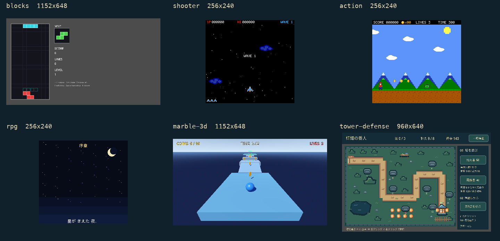

# Sample games

[日本語](samples.ja.md) · [Getting started](getting-started.md) · [Architecture](architecture.md)

The current source showcases six games. They run as standalone Godot projects without the MCP addon or an AI account.
These six games ship in **0.12.0**; see [distribution status](getting-started.md#distribution-status) for older versions.



These are actual native frames, not generated mockups. The RPG image is the prologue.
[Capture provenance](images/samples-current-provenance.json). Individual originals are linked in each entry.

<!-- sample-showcase:start -->
| Sample | Game | What to inspect |
|---|---|---|
| `blocks` | Falling Blocks | Rotation, board state and scoring |
| `shooter` | Vertical Shooter | Movement/fire, waves and boss transitions |
| `action` | Side-scroller | Variable jumps, platforms and collision |
| `rpg` | Luka of the Star Sword | Dialogue, battles and state transitions |
| `marble-3d` | Marble Run | Rolling, jumps, checkpoints and contacts |
| `tower-defense` | 灯畑の番人 | Tower placement, pause, victory/defeat and retry |
<!-- sample-showcase:end -->

## Copy and run

From your working folder, select one of the six IDs above:

```sh
npx -y godot-mcp-loop@0.12.0 sample shooter ./my-shooter
godot --headless --path ./my-shooter --import
godot --path ./my-shooter
```

Choose a new/empty destination. Source users can build server/ and invoke its absolute CLI path; keep installation/connection bound to that same build.
In the repository project, open the entry scene and press F6; in a standalone project, F5 runs its configured main scene.
Only agent editing/testing needs an explicit addon install and separate [client registration](clients.md) from the same distribution.

## Falling Blocks (`blocks`)

- **Goal:** Clear full rows before the board fills.
- **Controls:** ←/→ move; ↑/X clockwise, Z counterclockwise, ↓ soft drop, Space hard drop.
- **Retry:** R restarts; Enter also restarts after game over.
- **Observe:** Board state, rotation/kicks, fixed sequences and line scoring.
- **Checks:** 4 scenarios in `examples/blocks/scenarios/`; controlled hooks are distinct from an ordinary full route.
- **Project:** CLI ID `blocks`; entry `res://examples/blocks/blocks.tscn`. [Play guide](../examples/blocks/README.md) · [Design](../examples/blocks/DESIGN.md) · [Changes](../examples/blocks/UPGRADING.md) · [Image](images/samples-current-blocks.png).

## Vertical Shooter (`shooter`)

- **Goal:** Survive enemy waves and defeat the boss.
- **Controls:** Enter starts; arrows/WASD move; hold Z/Space/J to fire.
- **Retry:** After the results delay, Enter returns to title; Enter starts again.
- **Observe:** Input/fire bounds, damage, boss changes and recording; preserve the 256×240 aspect.
- **Checks:** 4 scenarios in `examples/shooter/scenarios/`; controlled hooks are distinct from an ordinary full route.
- **Project:** CLI ID `shooter`; entry `res://examples/shooter/shooter.tscn`. [Play guide](../examples/shooter/README.md) · [Design](../examples/shooter/DESIGN.md) · [Changes](../examples/shooter/UPGRADING.md) · [Image](images/samples-current-shooter.png).

## Side-scroller (`action`)

- **Goal:** Cross platforms and hazards to reach the stage goal.
- **Controls:** Arrows/A/D move; Z/Space jumps, holding longer for more height.
- **Retry:** Enter restarts after clear/game over and its result delay.
- **Observe:** Acceleration, variable jumps, camera, platforms and enemy contact.
- **Checks:** 4 scenarios in `examples/action/scenarios/`; controlled hooks are distinct from an ordinary full route.
- **Project:** CLI ID `action`; entry `res://examples/action/action_game.tscn`. [Play guide](../examples/action/README.md) · [Design](../examples/action/DESIGN.md) · [Changes](../examples/action/UPGRADING.md) · [Image](images/samples-current-action.png).

## Luka of the Star Sword (`rpg`)

- **Goal:** Explore, talk, battle and recover the Star Orb.
- **Controls:** Arrows move; Z/Enter/Space confirm; X/Esc cancel. Japanese text needs a Japanese font.
- **Retry:** Defeat returns to the castle starting position with half the gold. Stop/relaunch for a full reset.
- **Observe:** Dialogue, field/battle transitions, growth and defeat recovery.
- **Checks:** 6 scenarios in `examples/rpg/scenarios/`; controlled hooks are distinct from an ordinary full route.
- **Project:** CLI ID `rpg`; entry `res://examples/rpg/main.tscn`. [Play guide](../examples/rpg/README.md) · [Design](../examples/rpg/DESIGN.md) · [Changes](../examples/rpg/UPGRADING.md) · [Image](images/samples-current-rpg.png).

## Marble Run (`marble-3d`)

- **Goal:** Collect coins and roll/jump to the goal.
- **Controls:** Enter starts; arrows/WASD roll relative to the camera; Space jumps when grounded.
- **Retry:** After clear/game over and the result lock, Enter returns to title; Enter starts a new run.
- **Observe:** Motion, grounding, checkpoints, visibility, rays and contacts.
- **Checks:** 7 scenarios in `scenarios/ (repository: examples/marble/scenarios/)`; controlled hooks are distinct from an ordinary full route.
- **Project:** CLI ID `marble-3d`; entry `res://main.tscn (repository: res://examples/marble/main.tscn)`. [Play guide](../samples/marble-3d/README.md) · [Design](../samples/marble-3d/DESIGN.md) · [Changes](../samples/marble-3d/UPGRADING.md) · [Image](images/samples-current-marble-3d.png).

## 灯畑の番人 (`tower-defense`)

- **Goal:** Defend the seedhouse through three waves using two complementary towers.
- **Controls:** Click the start/tower/pad/wave controls; right-click deselects.
- **Retry:** Use the on-screen pause/resume, result retry, title and quit buttons.
- **Observe:** Placement, costs/ranges, pause and win/loss reset; three construction plans add 13/30/11 nodes.
- **Checks:** 2 scenarios in `scenarios/ (repository: examples/tower-defense/scenarios/)`; controlled hooks are distinct from an ordinary full route.
- **Project:** CLI ID `tower-defense`; entry `res://scenes/title.tscn (repository: res://examples/tower-defense/scenes/title.tscn)`. [Play guide](../samples/tower-defense/README.md) · [Design](../samples/tower-defense/DESIGN.md) · [Changes](../samples/tower-defense/UPGRADING.md) · [Image](images/samples-current-tower-defense.png).

## Verification and internal fixtures

The six showcased games contain 27 expected-success scenarios in total. Seeds, warps, invincibility, selected checkpoints
and direct state changes are labelled fixtures; they do not establish ordinary full-game completion.
The minimal platformer remains an internal compatibility fixture, with one positive scenario and one deliberate failure;
it is not a seventh showcased game. Its existing `Player` paths, default scene and CLI compatibility are retained.

Input, state, images, native logs and actual mixed PCM answer different questions; human play/listening approval is separate.
Use `screenshot {normalize: "none"}` when keeping a game's own window aspect, rather than scaling to the repository viewport.
See [scenarios](scenarios.md), [changes and source authorities](sample-upgrades.md), and [security](security.md).
